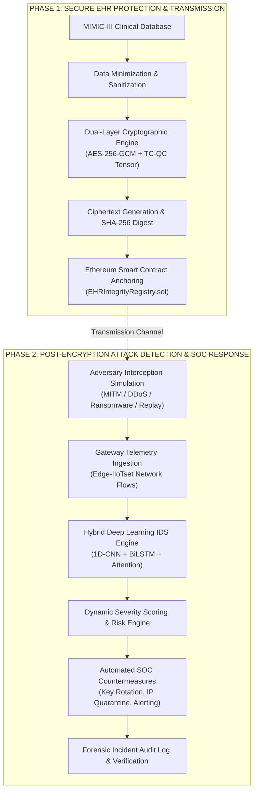

# Privacy-Preserving EHR Transmission with Cryptographic Protection, Blockchain Integrity, and AI-Based Post-Encryption Breach Detection & Automated Response

[](https://github.com/rupesh/Blockchain-EHR/actions)
[](https://www.python.org/downloads/)
[](https://opensource.org/licenses/MIT)
[](https://pytorch.org/)
[](https://streamlit.io/)
[](https://www.docker.com/)
[](https://soliditylang.org/)

A doctoral-grade cybersecurity, medical informatics, and distributed ledger platform synthesizing:
1. **Clinical Data Minimization & Ingestion**: Real-world ICU telemetry and laboratory records from the **MIMIC-III** clinical database.
2. **Dual-Layer Quantum-Resistant Cryptography**: Symmetric AES-256-GCM authenticated payload encryption coupled with Post-Quantum Tensor-Category Quantum Cryptography (TC-QC: $C = A \cdot (X \otimes K) \cdot B^T$) and simulated BB84 Quantum Key Distribution (QKD).
3. **Decoupled Blockchain Integrity Anchoring**: Dual smart contracts (`EHRAccessControl.sol`, `EHRIntegrityRegistry.sol`) anchoring immutable cryptographic SHA-256 digests and enforcing role-based access control (RBAC).
4. **Post-Encryption Deep Learning Intrusion Detection**: Hybrid **1D-CNN + BiLSTM + Multi-Head Self-Attention** network trained on the **Edge-IIoTset** benchmark dataset to identify active transmission attacks (MITM, DDoS, Injection, Ransomware) even when payloads remain securely encrypted.
5. **Automated SOC Incident Response Playbooks**: Dynamic severity classification (Critical, High, Medium, Low), live Ethereum key rotation, IP quarantining, and complete forensic audit logging.

---

## 🏛️ System Architecture



---

## 📂 Repository Structure

```
Blockchain-EHR/
├── .github/workflows/
│   └── ci.yml                 # Automated continuous integration pipeline
├── .streamlit/
│   └── config.toml            # Streamlit SOC dark theme and server settings
├── Dockerfile                 # Production-hardened containerization recipe
├── .dockerignore              # Docker build context exclusions
├── docker-compose.yml         # One-command orchestration service
├── LICENSE                    # MIT open-source license
├── README.md                  # System documentation and operational manual
├── requirements.txt           # Explicit Python dependencies with version bounds
├── config.yaml                # Central system, ML, blockchain, and crypto configs
├── conftest.py                # Pytest global fixtures and path configurations
├── run.sh                     # Unix/macOS demonstration launcher
├── run.bat                    # Windows demonstration launcher
├── app.py                     # Streamlit multi-page application entrypoint
│
├── pages/                     # 20-Page Comprehensive 2-Phase Research Pipeline
│   ├── 01_Overview.py                     # Executive Overview & System Topology
│   ├── 02_EHR_Data.py                     # EHR Data Center (MIMIC-III Exploration)
│   ├── 03_Phase1_Before_Encryption.py     # Phase 1: Plaintext EHR Schema
│   ├── 04_Phase1_Encryption.py            # Phase 1: Dual Cryptographic Engine
│   ├── 05_Phase1_After_Encryption.py      # Phase 1: Ciphertext & Blockchain Anchoring
│   ├── 06_Crypto_Comparison.py            # Cryptographic Benchmark Comparison
│   ├── 07_Key_Management.py               # Key Management & Rotation
│   ├── 08_Blockchain.py                   # Distributed Ledger Explorer
│   ├── 09_Smart_Contract.py               # Smart Contract Access Governance
│   ├── 10_Phase2_Breach_Simulation.py     # Phase 2: Transmission Breach Simulation
│   ├── 11_IDS_Detection.py                # Phase 2: AI IDS Detection Engine
│   ├── 12_Attack_Classification.py        # Attack Classification & Confusion Matrix
│   ├── 13_False_Positives_Negatives.py    # False Positive / Negative Risk Audit
│   ├── 14_Severity_Response.py            # Severity Scoring & Automated Response
│   ├── 15_Alert_Center.py                 # Security Operations Alert Center
│   ├── 16_Recommended_Actions.py          # Incident Response SOP Playbooks
│   ├── 17_Incident_Timeline.py            # Forensic Incident Audit Log
│   ├── 18_Explainable_AI.py               # Explainable AI (SHAP Global & Local)
│   ├── 19_Performance_Benchmarks.py       # Real-time Benchmarks & Manuscript Parity
│   └── 20_Complete_Architecture.py        # End-to-End System Block Diagram & 3D Topology
│
├── ehr/                       # Clinical EHR Minimization & Payload Handling
│   ├── loader.py              # MIMIC-III clinical table discovery & loader
│   ├── payload.py             # EHR record encapsulation & serialization
│   ├── sanitizer.py           # HIPAA Safe Harbor PII scrubbing
│   └── serializer.py          # Deterministic JSON / canonical byte encoding
│
├── crypto/                    # Cryptographic Engines & Post-Quantum Algorithms
│   ├── encryption.py          # AES-256-GCM, RSA, ChaCha20 implementations
│   ├── key_management.py      # Automated key derivation, rotation, and revocation
│   ├── hashing.py             # SHA-256, Keccak-256, HMAC-SHA256 digests
│   ├── qkd_simulation.py      # BB84 Quantum Key Distribution simulator
│   ├── tcqc_simulation.py     # Tensor-Categorical Quantum Cryptography
│   └── signatures.py          # ECDSA and Quantum-Resistant Digital Signatures
│
├── blockchain/                # Ethereum Web3 Integration & Fallback Ledger
│   ├── contract_client.py     # High-level Web3 client with auto-Ganache detection
│   ├── web3_client.py         # Low-level RPC connection manager
│   └── python_ledger.py       # Zero-dependency local cryptographic ledger fallback
│
├── ids/                       # AI Intrusion Detection & Post-Encryption Defense
│   ├── inference.py           # Real-time hybrid neural inference engine
│   ├── preprocessing.py       # Feature scaling, imputation & encoding
│   ├── response.py            # Automated mitigation & quarantine engine
│   ├── risk.py                # Composite risk and criticality assessment
│   ├── severity.py            # SOC alert severity scoring logic
│   └── simulation.py          # Attack injection & breach simulation
│
├── blockchain_truffle/        # Solidity Smart Contracts & Migrations
│   ├── contracts/             # Solidity source files (EHRAccessControl, EHRIntegrity)
│   ├── migrations/            # Deployment migration scripts
│   └── truffle-config.js      # Truffle network configuration
│
├── artifacts/                 # Serialized Models, Datasets & Benchmarks
│   ├── models/                # Trained PyTorch model & model manifest
│   ├── preprocessing/         # Scaler & feature transformers
│   ├── features/              # Mutual information ranking scores
│   ├── results/               # Confusion matrices, ROC/PR curves, benchmark tables
│   └── xai/                   # Precomputed SHAP values & importance
│
├── scripts/                   # Production CLI Tooling
│   ├── prepare_dataset.py     # Data extraction and feature engineering
│   ├── train_offline.py       # Full-scale neural network training
│   ├── evaluate_offline.py    # Held-out test set statistical evaluation
│   ├── generate_figures.py    # Publication figures and HTML charts generator
│   └── validate_artifacts.py  # Integrity gate validating model & feature hashes
│
└── tests/                     # Test Suite (100% Passing)
    ├── test_blockchain.py     # Ledger and cryptographic block tests
    ├── test_contract.py       # Smart contract RBAC & integrity tests
    ├── test_crypto.py         # AES-GCM, QKD, and TC-QC tests
    ├── test_data.py           # Schema extraction and data tests
    ├── test_end_to_end.py     # Complete end-to-end integration test
    ├── test_end_to_end_demo.py# 10-step full workflow verification test
    ├── test_models.py         # Deep learning and classical fallback tests
    └── test_preprocessing.py  # Preprocessing and leakage isolation tests
```

---

## 🚀 Quick Start Guide

### Option 1: Local Python Environment (Recommended for Development)

```bash
# 1. Clone the repository
git clone https://github.com/rupesh/Blockchain-EHR.git
cd Blockchain-EHR

# 2. Create and activate virtual environment
python3 -m venv .venv
source .venv/bin/activate  # On Windows: .venv\Scripts\activate

# 3. Install production dependencies
pip install -r requirements.txt

# 4. Verify system integrity
python scripts/validate_artifacts.py
pytest -v tests/

# 5. Launch the SOC Dashboard
streamlit run app.py
```

### Option 2: Docker Container (Production Deployment)

```bash
# Build the production image
docker build -t blockchain-ehr-soc .

# Run the containerized platform
docker run -d -p 8501:8501 --name ehr-soc blockchain-ehr-soc

# Access the platform at http://localhost:8501
```

### Option 3: Docker Compose

```bash
docker compose up -d
```

---

## ⛓️ Blockchain Setup (Optional Live Ganache Mode)

The platform features **Dual-Mode Operation**:
- **Automatic Simulation Mode (Default)**: Runs out of the box with zero external dependencies, using an internal in-memory SHA-256 blockchain ledger.
- **Live Ethereum Mode**: Automatically connects when Ganache is running on `http://127.0.0.1:8545`.

To run with live Ganache:
```bash
# Start local Ethereum testrpc
npx ganache --port 8545 --chainId 1337

# Deploy Solidity smart contracts (in a separate terminal)
cd blockchain_truffle
npx truffle migrate --reset --network development
```

The Streamlit dashboard detects Ganache automatically and anchors hashes directly to Ethereum transactions.

---

## 🧪 Testing & Verification

Execute the complete 24-test unit, integration, and end-to-end verification suite:

```bash
pytest -v tests/
```

Validate cryptographic hashes of all serialized models and preprocessors:

```bash
python scripts/validate_artifacts.py
```

---

## 📄 License

This research and software package is licensed under the [MIT License](LICENSE).
