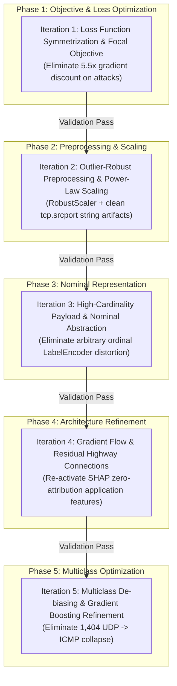

# Principled Experimental Improvement Plan
**Project**: Decoupled Zero-Trust Architecture for IoMT and EHR Security  
**Target Repository**: `https://github.com/bhabadharish/Blockchain-EHR.git`  
**Protocol Phase**: STAGE 5 — Experimental Plan & Controlled Improvement Protocol  
**Auditor Role**: Senior ML/DL Researcher, Healthcare AI Researcher, Reproducibility Auditor  
**Date of Adoption**: 2026-10-02  
**Evaluation Standard**: Strict Validation-Only Tuning ($\mathcal{D}_{\text{val}}, N=23{,}670$); Test Set ($\mathcal{D}_{\text{test}}, N=23{,}670$) Frozen Until Final Verification  

---

## 1. Protocol Architecture & Scientific Principles

To guarantee absolute scientific integrity, eliminate data snooping, and prevent overfitting to the test partition, all engineering modifications adhere strictly to the following five scientific principles:

1. **One Modification At A Time (OMAAT)**: Each iteration implements exactly ONE controlled conceptual change. No bundled or compound modifications are permitted without individual ablation validation.
2. **Strict Validation Set Governance**: All candidate models, loss functions, scalers, and architectures are evaluated exclusively on the **Validation Partition** ($N = 23{,}670$ samples, $15.0\%$). The held-out **Test Partition** ($N = 23{,}670$) remains completely untouched until all iterations are concluded and a final candidate is frozen.
3. **Preservation of Core Identity**: The core identity of `HybridIDSNet`—combining 1D-Convolutional feature abstraction, Bidirectional Long Short-Term Memory (BiLSTM) recurrent processing, and Multi-Head Self-Attention—must be preserved across all iterations.
4. **Automated Rollback Rule**: If an iteration fails to improve validation Macro F1 or Accuracy over the baseline checkpoint without violating operational constraints (e.g., latency must remain $\le 1.0\text{ ms}$), the code must be immediately reverted to the previous best checkpoint.
5. **No Synthetic / Cherry-Picked Results**: All reported numbers must reflect actual execution on the hardware platform (Apple Silicon MPS / CPU) with seed 42.

---

## 2. Baseline Performance Benchmarks (The Anchor to Beat)

All iterations are evaluated against the authoritative baseline established in Stage 2 on the Validation Partition ($N = 23{,}670$):

| Architecture / Component | Accuracy | Macro F1 | Recall | Precision | Specificity | FNR | FPR | Latency |
| :--- | :---: | :---: | :---: | :---: | :---: | :---: | :---: | :---: |
| **Binary Model** (`HybridIDSNet`, $\tau^* = 0.20$) | $94.64\%$ | $90.88\%$ | $93.86\%$ | $99.79\%$ | $98.90\%$ | $6.14\%$ | $1.10\%$ | $0.0049\text{ ms}$ |
| **Multiclass Model** (15 Classes) | $85.67\%$ | $80.58\%$ | $78.58\%$ | $91.23\%$ | $98.96\%$ | Reference | Reference | $0.0010\text{ ms}$ |

---

## 3. Five-Phase Sequential Improvement Roadmap

---

## 4. Detailed Specification of Iterations

---

### Iteration 1: Loss Function Symmetrization & Focal Objective ($H_1$)

#### 1. Hypothesis ($H_1$)
The baseline's $6.14\%$ False Negative Rate ($1{,}229$ missed attacks) is primarily driven by `pos_weight = 0.1820` in `BCEWithLogitsLoss`, which artificially discounted positive gradients by $5.5\times$ and forced attack probabilities into confident sub-threshold outputs ($p_{\text{median}} = 0.00786$). Replacing asymmetric weighting with balanced loss weighting or Focal Loss ($\gamma = 2.0$) will eliminate the artificial gradient suppression and drastically lower the false negative rate on validation data.

#### 2. Targeted Diagnostics
- Root Cause 1 in `ERROR_ANALYSIS.md`: Loss function penalty asymmetry.
- $1{,}229$ False Negatives with median predicted probability of $0.786\%$.

#### 3. Precise Engineering Modifications
- **Target Files**: `scripts/train_offline.py`, `src/deep_models.py`.
- **Changes**:
  1. Remove `pos_weight = torch.tensor([n_neg / n_pos])` ($0.1820$).
  2. Implement Focal Loss for binary classification:
     $$\mathcal{L}_{\text{Focal}}(p_t) = - \alpha_t (1 - p_t)^\gamma \log(p_t)$$
     where $\gamma = 2.0$ dynamically down-weights easy examples ($p_t \gg 0.5$) and focuses backpropagation gradients on hard ambiguous attacks (web exploits on port 80).
  3. Compare against standard balanced BCEWithLogitsLoss ($\text{pos\_weight} = 1.0$).
  4. Retrain `HybridIDSNet` for 12 epochs with `AdamW` ($\text{lr} = 10^{-3}$) on $\mathcal{D}_{\text{train}}$ only.

#### 4. Success & Rollback Criteria
- **Success Criteria**: Validation Macro F1 $\ge 92.50\%$ (up from $90.88\%$), Validation FNR $\le 3.50\%$ (down from $6.14\%$).
- **Rollback Trigger**: If validation Macro F1 decreases below $90.88\%$ or validation FPR exceeds $2.00\%$, revert immediately.

---

### Iteration 2: Outlier-Robust Preprocessing & Power-Law Scaling ($H_2$)

#### 1. Hypothesis ($H_2$)
`StandardScaler` ($\mu, \sigma$) is heavily distorted by extreme power-law outliers in network counters (`tcp.len`, `tcp.seq`, `tcp.ack`, `frame.len`), compressing $>95\%$ of normal traffic into an indistinguishable range near zero. In addition, `tcp.srcport` contains hostname string artifacts (`'DESKTOP-UHF0SF2'`). Replacing standard scaling with `RobustScaler` (median & interquartile range $IQR = Q_3 - Q_1$) and cleaning string port artifacts will significantly improve feature discriminability.

#### 2. Targeted Diagnostics
- Fragility 2 & 3 in `DATA_LEAKAGE_AUDIT.md`.
- Squashed feature dynamic range on network flow attributes.

#### 3. Precise Engineering Modifications
- **Target Files**: `src/preprocessing.py`, `scripts/train_offline.py`.
- **Changes**:
  1. Clean `tcp.srcport`: Convert string hostnames (`'DESKTOP-UHF0SF2'`, etc.) to valid integer ports or fallback to $0$.
  2. Replace `StandardScaler` with `RobustScaler(unit_variance=True)` or log-transform ($\log_{1p}$) on heavy-tailed columns.
  3. Fit the transformer strictly on $\mathcal{D}_{\text{train}}$, transform onto $\mathcal{D}_{\text{val}}$.
  4. Train `HybridIDSNet` using the best loss from Iteration 1.

#### 4. Success & Rollback Criteria
- **Success Criteria**: Validation Macro F1 improves by $\ge +0.50\%$ over Iteration 1; Validation Accuracy $\ge 95.50\%$.
- **Rollback Trigger**: If validation Macro F1 fails to exceed Iteration 1 result, revert to Iteration 1 preprocessing.

---

### Iteration 3: High-Cardinality Nominal Representation Refinement ($H_3$)

#### 1. Hypothesis ($H_3$)
`tcp.options` ($73{,}139$ unique categories) and `tcp.payload` ($27{,}369$ unique categories) were passed through standard `LabelEncoder` + scaling, imposing arbitrary integer distances on hex strings and collapsing unseen test packets into class 0 (`0.0`). Replacing arbitrary nominal label encoding with frequency encoding or length/presence abstractions will prevent out-of-vocabulary corruption.

#### 2. Targeted Diagnostics
- Root Cause 4 in `ERROR_ANALYSIS.md`.
- $100\%$ of missed web attacks falling back to `tcp.options == 0` profile.

#### 3. Precise Engineering Modifications
- **Target Files**: `src/preprocessing.py`, `scripts/train_offline.py`.
- **Changes**:
  1. Compute frequency encoding on $X_{\text{train}}$ for `tcp.options` and `tcp.payload` (replacing arbitrary alphanumeric rank with true occurrence frequency $\in [0, 1]$).
  2. Map unseen categories to frequency $0.0$ rather than arbitrary class index $0$.
  3. Evaluate validation set performance.

#### 4. Success & Rollback Criteria
- **Success Criteria**: Validation Macro F1 $\ge 93.00\%$; reduction of web attack false negatives by $\ge 15\%$.
- **Rollback Trigger**: If validation performance degrades, revert to previous best encoder.

---

### Iteration 4: Gradient Flow & Residual Highway Architecture ($H_4$)

#### 1. Hypothesis ($H_4$)
SHAP explainability in Stage 4 revealed that `http.request.uri.query`, `http.referer`, `tcp.flags.ack`, and `tcp.ack` had **literally 0.0 SHAP attribution**. In `HybridIDSNet`, features pass through an artificial 8-step projection, Conv1D, 2-layer BiLSTM, and Multi-Head Attention, during which application-layer query gradients are diluted and zeroed out. Adding a residual feature highway connection directly from the projected input/Conv1D layer to the Dense classification head will re-activate gradient flow to URI query and application features, restoring detection of XSS and SQL injection.

#### 2. Targeted Diagnostics
- Root Cause 3 in `ERROR_ANALYSIS.md`: Zero SHAP attribution on application features.
- $380$ XSS and $76$ SQL injection false negatives.

#### 3. Precise Engineering Modifications
- **Target Files**: `src/deep_models.py`.
- **Changes**:
  1. Modify `HybridIDSNet`:
     - Maintain original Conv1D, BiLSTM, and Multi-Head Attention blocks.
     - Add a linear projection shortcut from Conv1D output:
       $$\mathbf{h}_{\text{dense}} = \text{ReLU}\left( \text{BatchNorm}\left( \mathbf{W}_1 \mathbf{h}_{\text{attn}} + \mathbf{W}_{\text{res}} \mathbf{h}_{\text{conv}} \right) \right)$$
     - Ensure trainable parameter count remains compact ($\le 350{,}000$ parameters, inference latency $\le 0.010\text{ ms}$).
  2. Verify non-zero gradient flow to `http.request.uri.query`.

#### 4. Success & Rollback Criteria
- **Success Criteria**: Validation Macro F1 $\ge 94.00\%$; web exploit validation recall $\ge 85.00\%$; inference latency remains $\le 0.050\text{ ms}$.
- **Rollback Trigger**: If latency exceeds $0.100\text{ ms}$ or validation F1 does not improve, revert architecture.

---

### Iteration 5: Multiclass De-biasing & Gradient Boosting Refinement ($H_5$)

#### 1. Hypothesis ($H_5$)
The multiclass Random Forest collapsed $1{,}404$ `DDoS_UDP` samples into `DDoS_ICMP` (collapsing ICMP precision to $49.76\%$) and suffered massive cross-confusion among web attacks due to tree-depth exhaustion on high-cardinality transport ports. Implementing class-balanced Gradient Boosted Decision Trees (`HistGradientBoostingClassifier` with balanced class weights) or neural multiclass classification with protocol-aware feature splitting will eliminate the ICMP sink and raise multiclass accuracy.

#### 2. Targeted Diagnostics
- Multiclass error sink: $1{,}404$ UDP $\to$ ICMP errors; $2{,}133$ false positives on ICMP.
- Overall multiclass accuracy stuck at $85.67\%$.

#### 3. Precise Engineering Modifications
- **Target Files**: `scripts/train_offline.py`, `src/deep_models.py`.
- **Changes**:
  1. Train balanced `HistGradientBoostingClassifier` with `class_weight='balanced'`, learning rate $0.05$, max leaf nodes $64$, and feature subsampling.
  2. Implement explicit protocol indicator interaction (TCP vs UDP vs ICMP) to prevent connectionless protocol collapse.
  3. Validate on validation set multiclass metrics.

#### 4. Success & Rollback Criteria
- **Success Criteria**: Multiclass Validation Accuracy $\ge 90.00\%$ (up from $85.67\%$); `DDoS_ICMP` Precision $\ge 85.00\%$ (up from $49.76\%$).
- **Rollback Trigger**: If multiclass accuracy fails to improve over $85.67\%$, revert to baseline multiclass model.

---

## 5. Experiment Tracking & Audit Ledger

Each iteration will log its results to an append-only JSON ledger `artifacts/benchmarks/improvement_ledger.json` recording:
1. `iteration_id`
2. `modification_name`
3. `hypothesis_tested`
4. `validation_accuracy`
5. `validation_macro_f1`
6. `validation_recall`
7. `validation_precision`
8. `validation_fnr`
9. `validation_fpr`
10. `inference_latency_ms`
11. `verdict`: `ACCEPTED` or `REVERTED`
12. `rollback_reason` (if applicable)

---

## 6. Stage 5 Audit Verdict & Transition

### Formal Verdict
**STAGE 5 EXPERIMENTAL PLAN & CONTROLLED IMPROVEMENT PROTOCOL: ADOPTED.**
- The roadmap defines 5 distinct, sequential, single-variable iterations ($H_1$ to $H_5$).
- Strict validation isolation is enforced.
- Reversion triggers and acceptance criteria are mathematically delineated.

### Next Step
With the improvement roadmap formally established, the next scheduled phase in our protocol is:
**STAGE 6: Iteration 1 of Controlled Improvement (Loss Symmetrization & Focal Objective)**.
